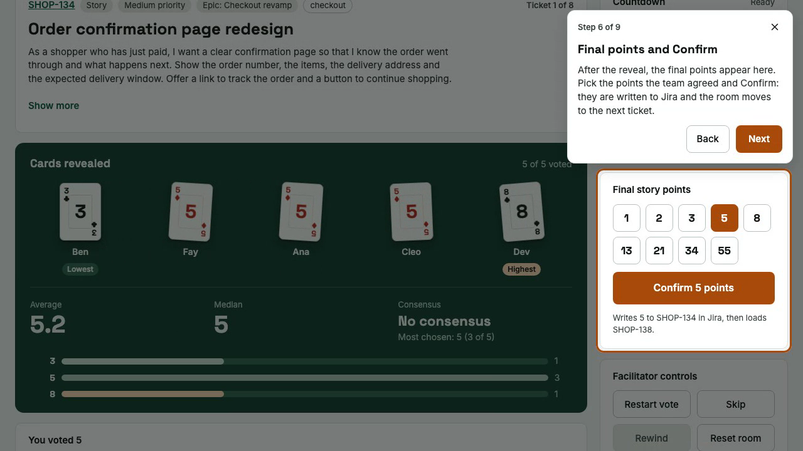

# Scrum poker

A multiplayer scrum poker web app for Jira Cloud. A facilitator walks the team through the
unestimated tickets of a backlog in rank order; everyone votes with hidden cards; the agreed
story points are written back to Jira.

One lightweight container, one process. Votes and session counters live in memory; room
definitions live in one SQLite file.

Try it online, with no sign-in: <https://poker.nijalabs.com/> offers **Try a demo**, a
private practice room with bot players and a made-up backlog. Nothing there reaches Jira.

How to use it: the [user guide](docs/user-guide.md). How to run it: the
[admin guide](docs/admin-guide.md). An overview with screenshots: the
[project page](https://nijaba.github.io/scrum-poker/). What changed in each version: the
[latest release](https://github.com/nijaba/scrum-poker/releases/latest) and
[all releases](https://github.com/nijaba/scrum-poker/releases).

### The tour in 30 seconds

[](https://poker.nijalabs.com/tour.mp4)

A facilitator's walk through the room's built-in tour while the team votes, with a voice-over.
Click the picture to [play the video](https://poker.nijalabs.com/tour.mp4) (MP4, 30 seconds, with sound), served by the
online demo, since GitHub does not play videos kept in a repository. The narration is in [docs/video/tour-voiceover.md](docs/video/tour-voiceover.md).

## Quick start (local development)

Requires Python 3.13 or newer and Node 22.

```bash
python -m venv .venv && . .venv/bin/activate
pip install -e ".[dev]"
(cd frontend && npm install && npm run build)
SCRUM_POKER_FAKE_BACKLOG=tests/fixtures/fake_backlog.json SCRUM_POKER_FAKE_SSO=1 SCRUM_POKER_FAKE_JIRA=1 \
  ROOM_CREATOR_ALLOWLIST=owner@example.com uvicorn app.main:app --port 8000
```

Open <http://localhost:8000>, sign in as Olive Owner, create a room, then in its settings
Connect Jira, accept, and pick SHOP board. The fake sign-in and fake Jira run on localhost only.

Tests: `pytest` runs everything. The browser tests need `npm run build` and
`playwright install chromium`; the image tests need Docker running. Each skips, with the
reason, when its tool is missing. Run the browser tests in another engine with
`pytest tests/e2e --browser firefox` (or `webkit`).

CI (`.github/workflows/ci.yml`) runs on every pull request and every push to `main`: ruff and
svelte-check, then all of `pytest` (unit, integration, E2E in Chromium and the Docker image
cases), then the E2E tests again in Firefox and WebKit. A change that touches only
documentation (`docs/`, Markdown files, the project page) runs just the tests that read it
(guide pictures, links, the project page build); the other checks report as skipped. `scripts/ci_changes.sh` decides which.

Every change also gets a **Secret scan**: [gitleaks](https://github.com/gitleaks/gitleaks)
reads the whole git history, and the job is required. Known false positives go in
`.gitleaksignore`, with a comment.

The Dependency audit workflow (`.github/workflows/audit.yml`) runs `pip-audit` and
`npm audit`, and scans the production image with [Trivy](https://trivy.dev) (Debian
packages and the Dockerfile), when the dependencies or the Dockerfile change, every Monday,
and by hand. It fails on a known vulnerability (moderate or worse for npm; high or critical
with a fix for the image) but is not a required check. GitHub's CodeQL code scanning,
Dependabot alerts and security updates, and secret scanning with push protection are on in
the repository settings; `.github/dependabot.yml` keeps the pinned actions current.

Run the same locally with `gitleaks git .`, `pip-audit --skip-editable`,
`(cd frontend && npm audit)` and, after `docker build -t scrum-poker .`,
`trivy image --scanners vuln --severity HIGH,CRITICAL --ignore-unfixed scrum-poker`. The
Sandbox and Manual cases of the test plan stay outside CI and run before each release.

## Deploying

The app runs as one container behind a reverse proxy that ends TLS. `deploy/` holds a
ready setup with [Caddy](https://caddyserver.com), which gets and renews the certificate
by itself.

### What you need

- A machine with Docker and Docker Compose, reachable on ports 80 and 443 (other ports
  are possible, below)
- A DNS record for `poker.example.com` pointing at that machine
- Three OAuth apps, below

### 1. Register the OAuth apps

Each needs a callback address on the public hostname. Plain `http://` callbacks are refused.

| Provider | Where | Callback address |
| --- | --- | --- |
| Google | [Google Cloud console](https://console.cloud.google.com/apis/credentials), OAuth client ID, type "Web application" | `https://poker.example.com/auth/google/callback` |
| GitHub | [GitHub, Developer settings, OAuth Apps](https://github.com/settings/developers) | `https://poker.example.com/auth/github/callback` |
| Atlassian | [Atlassian developer console](https://developer.atlassian.com/console/myapps/), OAuth 2.0 (3LO) integration | `https://poker.example.com/auth/atlassian/callback` |

Google and GitHub are for owners and delegates; you can enable just one. Players never sign
in. In the Atlassian app, add the six Jira API scopes listed in `.env.example`, as granular
scopes, and set the callback under Authorization. The admin guide has the details.

### 2. Write the configuration

Copy `.env.example` to `.env` in the repository root and fill it in:

```bash
cp .env.example .env
python -c 'import secrets; print(secrets.token_urlsafe(48))'   # SESSION_SECRET
python -c 'from cryptography.fernet import Fernet; print(Fernet.generate_key().decode())'   # TOKEN_ENCRYPTION_KEY
```

| Variable | Value |
| --- | --- |
| `APP_BASE_URL` | `https://poker.example.com` |
| `SESSION_SECRET` | the first value above; at least 32 characters |
| `TOKEN_ENCRYPTION_KEY` | the second value above; encrypts stored Jira refresh tokens |
| `ROOM_CREATOR_ALLOWLIST` | who may create rooms, for example `google-domain:example.com` (formats in `.env.example`) |
| `GOOGLE_CLIENT_ID`, `GOOGLE_CLIENT_SECRET` | from the Google client |
| `GITHUB_CLIENT_ID`, `GITHUB_CLIENT_SECRET` | from the GitHub app |
| `ATLASSIAN_CLIENT_ID`, `ATLASSIAN_CLIENT_SECRET` | from the Atlassian app |
| `DEMO_ROOMS` | optional: `1` offers **Try a demo** on the home page, a private practice room with bots and a made-up backlog for anyone, no sign-in |
| `DEMO_MAX_ROOMS`, `DEMO_IDLE_SECONDS` | optional: how many demo rooms may run at once (default 20), and how long one lasts with nobody in it (default 1800 seconds) |
| `TOUR_VIDEO` | optional: `0` hides **Watch the video** on the home page |

The [admin guide](docs/admin-guide.md#settings) lists every setting.

Leave the development-only `SCRUM_POKER_FAKE_*` variables unset: the app refuses them
outside localhost. The compose file sets `DATABASE_PATH` and `FORWARDED_ALLOW_IPS` itself.

Keep `SESSION_SECRET` and `TOKEN_ENCRYPTION_KEY` stable. Changing the first signs everyone
out; changing the second disconnects every room from Jira until its owner reconnects.

### 3. Start it

Run a release rather than whatever `main` holds today. Releases are listed on
[GitHub](https://github.com/nijaba/scrum-poker/releases); check out the latest one:

```bash
git fetch --tags && git checkout "$(git tag --sort=-v:refname | head -1)"
```

```bash
cd deploy
docker compose --env-file ../.env up -d --build
docker compose logs -f app
```

Open <https://poker.example.com>. Caddy fetches the certificate on the first request,
which can take a few seconds. `--env-file ../.env` lets `.env` also set these, read by the
compose file and Caddy:

| Variable | Default | Purpose |
| --- | --- | --- |
| `SITE_HOST` | `poker.example.com` | The hostname Caddy serves. Change `APP_BASE_URL` and the OAuth callbacks to match. |
| `HTTP_PORT` | `80` | The port Caddy answers plain HTTP on, redirecting to HTTPS. |
| `HTTPS_PORT` | `443` | The port Caddy serves HTTPS on. |

With an HTTPS port other than 443, put it in `APP_BASE_URL` and the OAuth callbacks, for
example `https://poker.example.com:8443`. Let's Encrypt checks the domain on public port
80 or 443 only, so keep `HTTP_PORT=80` or `HTTPS_PORT=443` reachable from the internet;
otherwise Caddy needs a DNS challenge, which takes a Caddy build with your DNS provider's
plugin.

### How HTTPS works

- Caddy ends TLS, redirects `HTTP_PORT` to `HTTPS_PORT`, and passes `X-Forwarded-Proto` to
  the app.
- The app believes that header only from the addresses in `FORWARDED_ALLOW_IPS`. In the
  compose file that is `*`, which is safe only because the app's port is not published: only
  Caddy can reach it. Behind another proxy or load balancer, set it to the proxy's address.
- Outside localhost the app redirects any plain-HTTP request (308) to `APP_BASE_URL`, refuses
  plain WebSockets, sends `Strict-Transport-Security: max-age=31536000` on every response,
  and marks its cookies Secure. `/healthz` answers over plain HTTP, for health checks.
- Mini mode needs HTTPS: browsers offer the Picture-in-Picture window only on secure pages.

Using a different proxy: send all paths, including WebSocket upgrades on `/ws/`, to the
container's port 8000 (or `PORT`), and set `X-Forwarded-Proto`. Run exactly one replica.

### Behind an existing nginx

Use this when the server already has nginx on ports 80 and 443 for other sites, so Caddy
can't run there. `deploy/nginx/` starts the app alone, published on
`127.0.0.1:8100`, and holds an nginx site for it. Register the OAuth apps and write `.env`
as in steps 1 and 2, then from `deploy/nginx/`:

```bash
docker compose --env-file ../../.env up -d --build
```

```bash
sudo cp poker.example.com.conf /etc/nginx/sites-available/poker
sudo ln -s /etc/nginx/sites-available/poker /etc/nginx/sites-enabled/poker
sudo nginx -t && sudo systemctl reload nginx
sudo certbot --nginx -d poker.example.com
```

certbot adds the TLS block and the HTTP-to-HTTPS redirect to the site, and renews the
certificate by itself. If port 8100 is taken, set `APP_PORT` in `.env` and change
`proxy_pass` in the site to match.

- Always start compose from `deploy/nginx/`. From `deploy/` it would also start Caddy, which
  can't bind ports 80 and 443 while nginx holds them.
- The app's port is published on loopback only, so the internet reaches it only through
  nginx. `FORWARDED_ALLOW_IPS` stays `*`: the container sees every host connection, nginx's
  included, from Docker's gateway address, so anything running on the server itself could
  also reach the app and set `X-Forwarded-Proto`.
- Both compose files use the same project name and `rooms` volume, so moving from one setup
  to the other keeps the rooms.

### Running the image yourself

```bash
docker build -t scrum-poker .
docker run -d --name scrum-poker --env-file .env -e FORWARDED_ALLOW_IPS=<proxy address> \
  -v scrum-poker-rooms:/data -p 127.0.0.1:8000:8000 scrum-poker
```

The image runs as a non-root user, keeps the SQLite file at `/data/scrum-poker.sqlite3`,
listens on `PORT` (default 8000) and has a Docker health check on `/healthz`.

### One process, one replica

Live rooms (players, votes, the countdown, session counters) sit in the process's memory,
and the image runs a single uvicorn worker. Never scale it past one replica or one worker:
players in the same room would land in different processes and not see each other.

A restart or upgrade ends the live sessions: votes and session counters are gone, and
players' pages reconnect by themselves. Rooms, delegates, settings and Jira connections are
kept, and points already confirmed are in Jira, so the queue picks up where it left off.
Upgrade between sessions, to a release (here 1.2.0; the
[release notes](https://github.com/nijaba/scrum-poker/releases) say what changed, and a new
major version says what you must do):

```bash
git fetch --tags && git checkout v1.2.0
```

```bash
cd deploy
docker compose --env-file ../.env up -d --build
```

To go back, check out the previous release and run the same command. `/healthz` and the
footer of every page show the version running.

## Versions and releases

Scrum poker follows [semantic versioning](https://semver.org): a new **major** version
means something you must act on when you upgrade (a setting renamed or removed, a change to
the deploy files, a rooms-file migration that cannot be undone), a **minor** one adds
features, and a **patch** fixes bugs. `version` in `pyproject.toml` is the one source.

To make a release, merge a pull request that sets the new version in `pyproject.toml`, then
on an up-to-date `main` run `scripts/release.sh X.Y.Z`: it tags `vX.Y.Z` and publishes the
GitHub Release, with notes generated from the merged pull requests.

### Backups

The `rooms` volume holds the only state worth keeping: one SQLite file with room
definitions and encrypted Jira refresh tokens. Back it up with:

```bash
docker compose exec app python -c "import sqlite3; s = sqlite3.connect('/data/scrum-poker.sqlite3'); s.backup(sqlite3.connect('/data/backup.sqlite3'))"
docker compose cp app:/data/backup.sqlite3 ./scrum-poker-backup.sqlite3
```

A backup is useless without the same `TOKEN_ENCRYPTION_KEY`; keep that key somewhere safe,
apart from the backup.

## Working with Claude Code

Open this folder in Claude Code. `CLAUDE.md` gives it the constraints, commands and rules.

- `.claude/settings.json` lets it run `pytest` and `ruff` without asking each time.
- `.claude/rules/` holds extra rules that load when it works on the room engine or the front end.

## Sponsor

Scrum poker was built for [Tensormesh](https://tensormesh.ai), its first user, which sponsors
its development.

## Licence

[Apache License 2.0](LICENSE).

## Documents

- [Releases](https://github.com/nijaba/scrum-poker/releases): each version and what changed
- [docs/user-guide.md](docs/user-guide.md): for players, facilitators and room owners
- [docs/why-scrum-poker.md](docs/why-scrum-poker.md): what estimating with scrum poker gives a team
- [docs/admin-guide.md](docs/admin-guide.md): sign-in and Jira apps, settings, operations, troubleshooting
- [docs/design.md](docs/design.md): architecture and behaviour
- [docs/test-plan.md](docs/test-plan.md): test cases with IDs
- [docs/build-plan.md](docs/build-plan.md): the six build steps
- [docs/mockups/](docs/mockups/): the four screens as static HTML
- [docs/video/](docs/video/): the 30-second tour video, its voice-over script, and how to remake both
