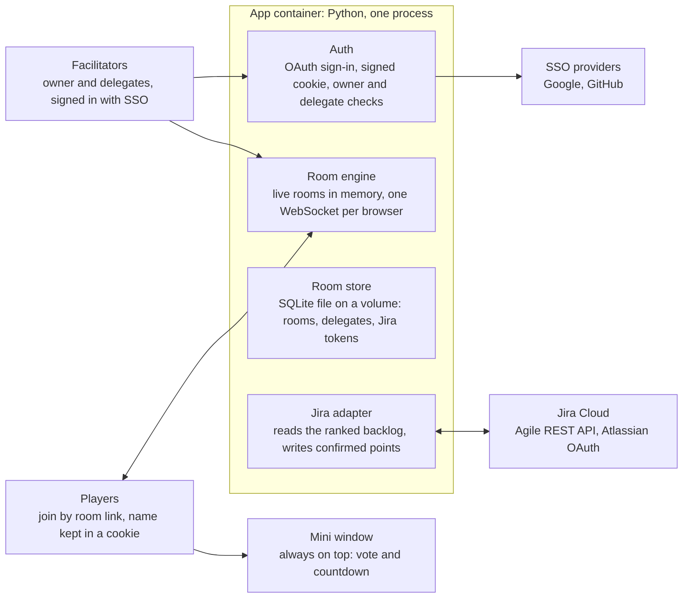

# Scrum poker design

> Copied on 2026-11-11 from the Claude doc [Scrum poker design](https://claude.ai/artifact/2NgE8aD1Hme6a5ovuD6AEY).
> If this file and the doc disagree, ask the owner which one is current.

Scrum poker runs as one Python container: it serves a small web app, keeps live rooms in memory, stores room definitions in a SQLite file, and reads the backlog from and writes story points to Jira Cloud.

## Architecture

Facilitators sign in through Auth and drive the room engine; players only hold a WebSocket to it. Room definitions go to the SQLite file, and confirmed points go to Jira.

## Stack

The app is written in Python: FastAPI on uvicorn for HTTP and WebSockets, Authlib for the OAuth flows, httpx for Jira calls, and the standard library's SQLite driver. The front end is a small single-page app in Svelte with TypeScript, built with Vite and served as static files.

Go is not required. It would give a smaller image (roughly 20 MB instead of around 150 MB) and lower memory use, and neither matters at team scale.

Run a single uvicorn worker. Live rooms sit in process memory, so several workers would split one room across processes.

## Room engine

Each live room is one asyncio task that owns its state and reads commands from a queue. After every change the server sends each client its own snapshot. Until reveal, a vote shows to everyone as a face-down card, and clients never receive the values.

A round moves through three states: voting, revealed, confirmed. The queue is a list of ticket keys, a cursor, and a result per ticket: estimated, skipped or pending.

Every screen shows two counters: tickets estimated and points assigned in this session, and the same pair for the whole backlog. Session totals are derived from the results, so re-estimating after a rewind never double counts.

### Facilitator controls

| Control | Effect |
| --- | --- |
| Start countdown | Starts a timer, 30 s by default, settable |
| Stop countdown | Stops a running timer without signalling time's up |
| Reveal | Turns all cards face up and shows the average, median and consensus |
| Restart vote | Clears the cards and reopens voting |
| Confirm points | Writes the chosen value to Jira, then moves to the next ticket |
| Skip | Moves to the next ticket without writing |
| Rewind | Returns to the previous ticket |
| Reset room | Clears the player list and the current cards, then seats only players who still respond |
| Auto-reveal | Reveals the cards by itself once every connected player at the table has voted. On or off for this session |
| Remove player | Takes one player off the table and drops their card. They can join again |
| Jump to a ticket | Moves straight to a ticket in Up next, which lists the next five. The ticket left behind keeps its result and is not marked skipped |
| Session summary | Copies or downloads this session's tickets with status, points, average and vote counts |

### Results on reveal

On reveal, every screen shows three figures next to the cards:

- Average: the mean of the numeric card values, to one decimal
- Median: the middle numeric card value, or the mean of the two middle values when the count is even
- Consensus: whether everyone chose the same card; if not, the most-chosen card and how many chose it

T-shirt cards count by their mapped values. Confirming a T-shirt card writes its mapped value.

The reveal also shows the spread: how many chose each card, in scale order, "?" included. When the numeric cards differ, the highest and lowest are marked, and so are the players who chose them, because the discussion usually starts with them.

Once the cards have turned over, the seats move into scale order: lowest card first, cards without a value such as "?" after the numbers, and players who did not vote last. Players who chose the same card keep their seating order. Restarting the vote puts the seats back in the order players joined. The turn and the move are animated; when the browser asks for reduced motion, the cards turn and sort at once, with no animation.

### Auto-reveal

Auto-reveal turns the cards over once every player at the table who is connected has voted. Away players and players sitting out do not hold it up, and it needs at least one vote. It is a room setting, off by default, that the owner saves; facilitators can switch it for the running session only, like the countdown sound. Switching it on when everyone has already voted reveals at once. It never fires on countdown expiry, which still only signals time's up.

### Sitting out and removing players

Anyone can sit out: they leave the table, their card is dropped, and the voted count stops waiting for them, but they still see the room and a facilitator keeps the facilitator panel. Choosing to join the table again seats them. Sitting out survives a room reset.

A facilitator can remove one player from the table, for a duplicate seat or someone who left. Their seat and card go. If their browser is still open it says a facilitator removed them and offers to join again; reloading the page joins again too.

### Session summary

Facilitators get a summary of the session: every ticket estimated or skipped so far, in queue order, with its points, the average on reveal, and how many chose each card. It lists no names. It is built from the session's memory and never stored, so it ends with the session. The browser turns it into text to copy or a CSV file to download.

### Little extras

A few small touches, decided by the owner on 2026-11-13:

- Coffee break: a player at the table can press ☕ next to their cards to say they need a break. It is a signal, not a vote: it never touches the round's votes, it does not count as voted, and auto-reveal still waits for them. Every screen shows a cup by their name and plays a short gurgle when the break starts, and the break ends when they press ☕ again or vote. Players sitting out cannot take one. A reset clears it with the seats.
- Splitting hint: when anyone chose the scale's highest numeric card (55 on Fibonacci, XXL on the default T-shirt scale, the top of a custom list), the results add "Have you considered splitting this?". A scale needs at least two numeric values for the hint.
- Nobody knows: when every vote is a card without a value, such as "?", the consensus figure reads "Nobody knows. Ship it?" instead.
- Perfect consensus: when at least five players all chose the same numeric card, the results say so, the cards take a bow one after another and a short chord plays. With reduced motion the cards stay still.

- Arcade deck: typing the Konami code (↑ ↑ ↓ ↓ ← → ← → B A) anywhere outside a text field switches your own cards to a neon arcade deck; typing it again brings the classic deck back. It is a browser-only preference, kept in local storage, and also applies in mini mode. Nobody else's screen changes, and the server is not told.

The server works out the hint, "nobody knows" and the perfect consensus with the other results, so every screen agrees. The gurgle and the chord follow the room's sound setting and each player's mute, like the countdown sound.

### Room reset

A facilitator can reset the room to clear out players who have left. The server empties the player list and the current cards, then asks every connected browser to check in. Only players who answer within five seconds (a server setting) are seated again, and anyone who joins later is seated as a new player.

The reset keeps the room's settings, the queue position and the session counters. Voting on the current ticket reopens.

### Countdown and sound

The countdown is a server-side deadline that clients render locally. Expiry only signals "time's up"; the facilitator decides when to reveal. Reveal stops a running countdown, and "time's up" stays shown until the next round.

Sound is a room setting, off by default: soft ticks for the last five seconds and a chime at zero. It is synthesized in the browser, so there are no audio files, and each player can mute it locally.

### Scales

The owner picks Fibonacci (1, 2, 3, 5, 8, 13, 21, 34, 55, ?), T-shirt or a custom list per room and can change it between rounds. A change made before anyone has voted applies at once; otherwise it applies from the next round (a restart or the next ticket). Each card has a label and an optional numeric value, because Jira's story points field is a plain numeric field ([source](https://docs.atlassian.com/jira-software/REST/2017-03-08T23:31:28Z/)). Fibonacci is not editable, so a room saved with an older Fibonacci list loads with the current one.

T-shirt sizes ship with an editable mapping: XS=1, S=2, M=3, L=5, XL=8, XXL=13. The settings mock-up's example stops at XL; XXL is part of the default. Cards without a value, such as "?", are left out of the statistics.

## Jira Cloud

The app connects through Atlassian OAuth 2.0, and requests go to `api.atlassian.com/ex/jira/{cloudId}` ([source](https://mrrefactoring.github.io/jira.js/guide/oauth2-authentication)). Jira Software only supports granular scopes ([source](https://developer.atlassian.com/cloud/jira/software/scopes-for-oauth-2-3LO-and-forge-apps/)).

| Scope | Used for |
| --- | --- |
| `read:board-scope:jira-software` | Reading boards and the backlog |
| `read:board-scope.admin:jira-software` | Reading the board configuration, which names the estimate field |
| `read:project:jira` | Listing boards and reading the board configuration |
| `read:issue-details:jira` | Reading ticket fields |
| `write:issue:jira-software` | Writing the estimate ([source](https://developer.atlassian.com/cloud/jira/software/oauth-2-authorization-code-grants-3lo-for-apps/)) |
| `read:me` | Showing which Atlassian account the room is connected as |
| `offline_access` | Getting a refresh token |

The scopes per endpoint come from Atlassian's Jira Software OpenAPI spec, checked on 11 November 2026. The first version of this design listed four; listing boards and reading the estimate field need the two `read:project` and `.admin` scopes, and the settings page shows the account through `read:me`.

Each room has one Jira connection, set up by its owner on the room's settings page. The backlog loads and every confirmed estimate is written through it, whoever confirms, so Jira's history names the owner. Delegates never connect Jira. An owner with several rooms connects each one, possibly to different Atlassian accounts or sites.

Refresh tokens rotate and expire after 90 days without use, so each room's latest token is stored encrypted (Fernet, with `TOKEN_ENCRYPTION_KEY`) in the SQLite file, and replaced after every refresh ([source](https://mrrefactoring.github.io/jira.js/guide/oauth2-authentication)). Access tokens stay in memory, and refreshes for one room run one at a time. If the connection is missing or Jira refuses the refresh token, facilitators see that the owner must connect or reconnect Jira, and the room stays where it is.

### Loading the backlog

On session start the adapter reads the board configuration for the estimate field, then calls `GET /rest/agile/1.0/board/{boardId}/backlog` page by page, which returns issues ordered by rank ([source](https://developer.atlassian.com/cloud/jira/software/rest/api-group-board)). One pass yields the queue (tickets with no estimate, in rank order) and the backlog counters. Epics and sub-tasks are left out of both: epics group tickets and sub-tasks split one, so neither is estimated on its own. Jira gives every issue type a hierarchy level (-1 sub-task, 0 standard, 1 epic) and a sub-task flag, which hold when a type is renamed or translated. Only issues at level 0 and not flagged as sub-tasks enter the queue; without a level, the type names `Epic`, `Sub-task` and `Subtask` are left out. Tickets already started are left out too: an issue must sit in Jira's To Do status category (key `new`), so a status called Backlog, Open or To Do counts, in any language, and In Progress or Done does not. A ticket with a resolution (Done, Won't Do) is left out even in a To Do status, which some workflows allow. Tickets in the active sprint or a future sprint are left out; the backlog endpoint already omits them, and the adapter checks each issue's `sprint` field so the rule holds whatever the endpoint returns. A ticket whose only sprint has closed is back in the backlog and counts. A room with no board chosen, or whose backlog cannot load, says why, and facilitators can retry once the owner has fixed it.

A session ends when nobody has been connected to the room for 15 minutes. The next visit starts a new session: the backlog loads again and the session counters start at zero. A short drop-out or a page reload keeps the session.

### Writing points

On confirm the adapter writes through the board's estimation endpoint. The estimation field is set per board configuration, and this endpoint works even when the field is not on an edit screen ([source](https://docs.atlassian.com/jira-software/REST/2017-09-06T07:06:51Z/)). The room advances only once Jira accepts the write.

### Ticket card

The card shows key and link, type, priority, epic, labels, and the Jira-rendered description, collapsed after a few lines. The rendered HTML is sanitized on the server with nh3 to an allowlist of formatting tags and http, https and mailto links before any browser sees it.

## Auth, rooms and delegates

Owners and delegates sign in; players only type a name.

Names at a table are unique, so everyone can tell who played what. The room refuses a name that another seat holds, whether that person is at the table, watching or away, ignoring case and extra spaces: "ana" is refused while "Ana" is seated. The same browser reconnecting keeps its own seat and name. A name is free again once its seat goes, by a removal, a log-out or a reset. A refused browser, including a returning one whose saved name is now taken, is sent back to the name form with the name it tried and the message "Someone at the table is already called Ana. Choose another name."

| Role | Signs in with | Can do |
| --- | --- | --- |
| Owner | Google or GitHub | Create, configure and delete rooms; name delegates; run sessions |
| Delegate | Google or GitHub | Run sessions in the rooms where the owner listed them |
| Player | Nothing | Vote |

Facilitator sessions live in a signed cookie, and an environment allowlist controls who may create rooms. The owner lists delegates per room by Google email or GitHub username. Matching uses the verified email or GitHub login, not the display name, which anyone can change.

### Sign-in

Sign-in is the OAuth 2.0 authorization-code flow with PKCE, through Authlib's client. The flow's state travels in a signed cookie that lasts ten minutes, so the server keeps no sign-in state. Google must report the email as verified. The session cookie is signed, HttpOnly and SameSite=Lax, lasts 30 days, and is Secure whenever the app is not on localhost. A tampered or expired cookie counts as signed out.

The owner is matched on the provider's stable account ID. A Google account matches only Google entries, and a GitHub account only GitHub entries.

### The menu behind your name

In the room header, your name and role are a button that opens a small menu:

| Who | Menu |
| --- | --- |
| Signed in, owner of the room | Your rooms, Room settings, Log out |
| Signed in, anyone else (delegate or player) | Your rooms, Log out |
| Not signed in | Log out |

Room settings is the only way to the settings page from the room header. Your rooms goes to the home page, which lists the rooms you own or help run. Log out first sends the room a `leave` command, which takes the seat and any vote off the table like a removal but without the "removed" notice. Then someone signed in is signed out and taken to the home page; their player name stays in the browser, so opening a room again seats them as a player under that name. A player who is not signed in has their player cookie cleared (`DELETE /api/player`) and sees the name form again; the next name they type is a new player.

### Who may create rooms

`ROOM_CREATOR_ALLOWLIST` is a comma-separated list. Each entry is one of these:

| Entry | Who may create rooms |
| --- | --- |
| `*` | Anyone signed in with Google or GitHub |
| `ana@example.com` | That Google account, by verified email |
| `github:ana-dev` | That GitHub login |
| `google-domain:example.com` | Any account in that Google Workspace, by the `hd` claim, not the email's domain |
| `github-org:acme` | Any active member of that GitHub organisation |

A `github-org:` entry makes GitHub sign-in ask for the `read:org` scope. Membership is checked at sign-in and kept in the session, so someone who leaves the org keeps create rights until their session ends. An org that restricts third-party apps must approve this app first; until then the check fails closed.

### Rooms

The rooms page at `/` offers sign-in when signed out. Signed in, it lists the rooms the account owns or is a delegate of, and allowlisted owners can create one there. Each room's settings page is at `/r/<slug>/settings` and only the owner can use it.

The owner can rename a room. The old short name keeps redirecting to the new one, also for room sockets, and no other room can take it. Deleting a room frees all its names and ends its live session on every screen.

Saved settings reach a live room through its command queue: a new scale from the next round, the timer default, sound and auto-reveal at once. In the facilitator panel, the Seconds field and the Sound and Auto-reveal toggles change the running session only, and never the saved defaults.

Writes to the JSON API refuse a foreign `Origin` and any body that is not JSON.

A local fake provider stands in for Google and GitHub in tests and development. It runs only when `SCRUM_POKER_FAKE_SSO=1`, and the app refuses that setting outside localhost.

A year-long cookie keeps each player's name and a random player ID. The server sets it (HttpOnly) when the player types a name, and the room's WebSocket reads it to seat the player. Returning players skip the name prompt and get their seat back after a reconnect.

### What is stored where

Room definitions persist, so the link `/r/<slug>` survives restarts. Nothing about sessions is stored.

| Data | Lives in | Survives a restart |
| --- | --- | --- |
| Room slug, owner, delegates, Jira site and board, scale, timer default, sound and auto-reveal settings | SQLite file | Yes |
| Each room's Jira connection: refresh token (encrypted), account email, site and board | SQLite file | Yes |
| Confirmed story points | Jira | Yes |
| Player name and ID | The player's cookie | Yes |
| Votes, results, session counters | Memory | No |

## Demo rooms

Demo rooms let anyone practise, as a player or a facilitator, with no sign-in and no Jira. The owner decided on 2026-11-13 that each visitor gets a private room of their own, with a team of bots and a made-up backlog. They are off unless `DEMO_ROOMS=1`.

- **Starting one.** With demo rooms on, the home page offers **Try a demo**. It asks the server for a new room, `demo-` and eight random letters and digits, and opens it. Short names starting with `demo-` are reserved, so a stored room can never take one.
- **Memory only.** A demo room never reaches SQLite. It lives as long as its live session: it ends, and its name stops working, after its idle time with no person connected, or on a restart. At most 20 run at once (`DEMO_MAX_ROOMS`), and the idle time is 30 minutes (`DEMO_IDLE_SECONDS`, in seconds). Past the limit, the server refuses a new one (503) with a light-hearted message: the bots are busy estimating someone else's backlog, so grab a coffee and come back in a few minutes. The home page shows it as a calm note with a steaming cup, not as an error, and **Try a demo** stays available to try again.
- **Everyone facilitates.** Anyone with the link gets the session controls, so the visitor can share it to bring colleagues in. There are no room settings: the scale is Fibonacci, the countdown 30 seconds, and the sound is on.
- **The backlog** is a copy of a sample backlog shipped with the app, made-up tickets in the same shape as Jira's, with some already estimated. Confirming points writes to that copy only, so the counters move; nothing reaches Jira, and no fake OAuth pages are exposed.
- **The bots** are four players, Ada, Bo, Cleo and Dev, who join with the room. They are ordinary connections inside the server: they see only their own snapshot and send the same commands a browser would, so the room task stays the only writer and votes stay hidden until reveal. A few seconds after each round opens, each bot votes near a size the ticket "really" is (the same for every bot), shifted by the bot's own habit of guessing high or low and a little chance; now and then one plays "?" or takes a short coffee break first. They answer a reset's check-in. A facilitator can remove a bot like any player, and **Add a bot** seats one more, up to eight. Bots do not keep a room alive: only people do.
- Every screen shows that it is a demo: the players are bots, the backlog is made up, and nothing reaches Jira.

## Mini mode

Mini mode is a small always-on-top window with the ticket key, the countdown, the card row and the voted count. It uses the Document Picture-in-Picture API, which works on desktop Chrome and Edge 116+ and Firefox 151+, but not Safari ([source](https://www.rabbitpair.com/en/products/dualpip/faqs/document-pip-browser-limits)). Safari falls back to a normal small popup, which does not stay on top.

The main tab stays open and holds the connection. The countdown sound plays from it, so sound works in mini mode too. The mini view is drawn by the main tab into the mini window, so votes go through the main tab's connection. While the mini window is open, its timer also keeps the main tab's countdown and sound on time, because browsers slow the timers of hidden tabs. A popup closes when the main tab closes; a Picture-in-Picture window does so by itself.

## HTTPS

The app is served over HTTPS only, and room connections use secure WebSockets. Local development on `localhost` is the one exception.

- TLS ends at a reverse proxy or load balancer in front of the container, and the app reads the proxy's forwarded-protocol header. It believes the header only from the addresses in `FORWARDED_ALLOW_IPS` (default `127.0.0.1`)
- A plain-HTTP request is redirected (308) to the same path on `APP_BASE_URL`, never to the Host the request named. A plain WebSocket is refused. `/healthz` answers over plain HTTP, for health checks
- Responses carry `Strict-Transport-Security: max-age=31536000`
- The session cookie and the player cookie are marked Secure
- Google, GitHub and Atlassian sign-in return to `https://` callback addresses

Production runs at `https://poker.example.com`, behind the nginx that already serves other sites on that host; nginx ends TLS with a certbot certificate and reaches the app on `127.0.0.1:8100` (`deploy/nginx/`). For a host of its own, `deploy/` puts [Caddy](https://caddyserver.com) in front of the container to end TLS and renew the certificate.

Mini mode depends on this too: the Document Picture-in-Picture API is only available on pages served over HTTPS ([source](https://developer.mozilla.org/docs/Web/API/Document_Picture-in-Picture_API)).

## Packaging and build order

A multi-stage Docker build compiles the single-page app in a Node stage, then copies it into a slim Python image that serves both the page and the API. Configuration comes from environment variables, the SQLite file sits on one mounted volume, and the app runs as a single replica. The image runs one uvicorn worker as a non-root user, keeps the SQLite file at `/data/scrum-poker.sqlite3`, listens on `PORT` (default 8000) and has a health check on `/healthz`. The app reads the proxy's headers itself, so uvicorn's own proxy-header handling is off.

The build goes in six steps:

1. Room engine against a fake backlog, with tests for scales, timer and sound cues
2. Room UI: ticket card, cards, facilitator controls, counters
3. SSO, persistent rooms and delegates
4. Jira: read the backlog, then write points
5. Mini window
6. Dockerfile and deployment notes

## Prior art

No existing project is a self-contained container with a Jira-driven queue, so the app is built rather than forked.

[scrumpoker-online.org](https://www.scrumpoker-online.org/en/) covers the participant flow well: no signup, just a shared room ID, link or QR code. It has no Jira sync, by design.

The three most-starred healthy open-source projects, with GitHub stars as of 11 November 2026:

| Project | Stars | Stack | Worth borrowing |
| --- | --- | --- | --- |
| [Thunderdome](https://github.com/StevenWeathers/thunderdome-planning-poker) | 500 | Go, Svelte, Postgres | Leader role, spectators, auto-finish voting |
| [planning-poker](https://github.com/hellomuthu23/planning-poker) | 351 | React, Firestore | Scale presets, voted/not-voted status |
| [AgileKit](https://github.com/spokvulcan/poker-planning) | 116 | Next.js, Convex | Two-way Jira Cloud sync over OAuth |

Three projects with more stars than AgileKit were skipped as inactive: scrumonline (407, no pushes since April 2023), poinz (159, quiet since May 2025) and self-host-planning-poker (132, archived).

## Sources

- [Scrum Poker Online](https://www.scrumpoker-online.org/en/): room flow, sign-in options, no Jira sync
- [Jira Software Cloud REST API, board group](https://developer.atlassian.com/cloud/jira/software/rest/api-group-board): backlog endpoint and rank order
- [Jira Software scopes for OAuth 2.0 (3LO)](https://developer.atlassian.com/cloud/jira/software/scopes-for-oauth-2-3LO-and-forge-apps/): granular scopes
- [OAuth 2.0 authorization code grants (3LO) for apps](https://developer.atlassian.com/cloud/jira/software/oauth-2-authorization-code-grants-3lo-for-apps/): the estimate scope
- [Jira Software REST API reference](https://docs.atlassian.com/jira-software/REST/2017-09-06T07:06:51Z/): estimation field and board configuration
- [jira.js OAuth 2.0 guide](https://mrrefactoring.github.io/jira.js/guide/oauth2-authentication): API routing and rotating refresh tokens
- [Document Picture-in-Picture browser limits](https://www.rabbitpair.com/en/products/dualpip/faqs/document-pip-browser-limits) and [web.dev, May 2026](https://web.dev/blog/web-platform-05-2026): browser support
- [MDN, Document Picture-in-Picture API](https://developer.mozilla.org/docs/Web/API/Document_Picture-in-Picture_API): the HTTPS requirement for mini mode
- GitHub API, queried 11 November 2026: star counts and last-push dates
